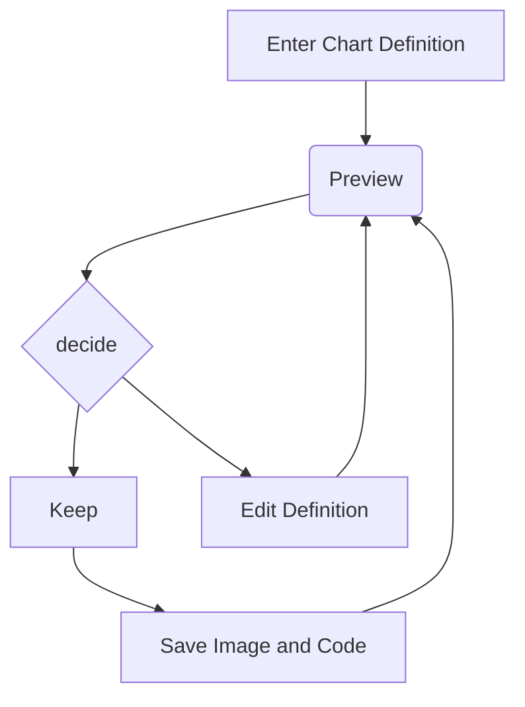

## Voyage dans un plugin
//@ [] 00:45

Le plugin `mermaid` s'utilise en introduisant une section *mermaid* dans le markdown.

<em>Le code</em>

<pre>

</pre>

<em>Le rendu</em>

Voyons comment le plugin génère le rendu...
