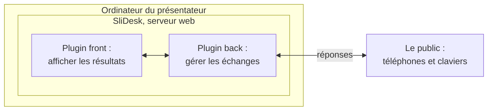

## SliDesk en serveur d'interactivité .[bigchart]
//@ [] 01:30

SliDesk est déjà un serveur web : il pourrait aussi servir des pages au public.

Deux plugins suffiraient :

/*
Théoriquement, SliDesk peut devenir son propre service d'interaction : c'est un serveur web, il peut donc servir des pages aux téléphones du public.

On imaginerait deux plugins complémentaires : un plugin back pour gérer les échanges avec le public (claviers virtuels, réponses), et un plugin front pour afficher les résultats directement dans la présentation.

Sur le diagramme : le public répond depuis son téléphone, le plugin back collecte, le plugin front affiche.

Séduisant sur le papier, mais ce serait un silo de plus, et la diapositive suivante explique pourquoi on ne l'a pas fait.
*/
