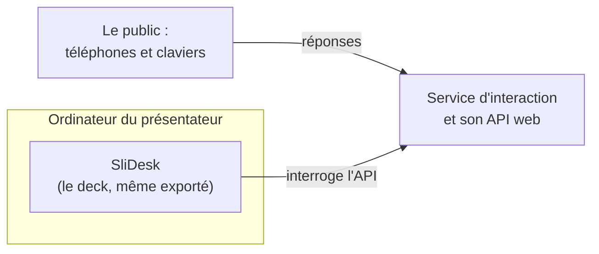

## SliDesk en visualiseur d'interactivité .[bigchart]
//@ [] 01:30

Un deck exporté perd le serveur, et un serveur de présentation n'est pas fait pour garder des données :\
SliDesk se limite donc à l'affichage, un service séparé gère l'interaction, avec une API web.

/*
L'approche précédente a deux défauts : une présentation exportée en HTML statique perd le serveur, donc l'interaction disparaît ; et un serveur de présentation n'a pas vocation à persister des données.

L'approche plus raisonnable garde SliDesk pour la partie affichage, et s'appuie sur un service d'interaction séparé : hébergé où l'on veut, indépendant, avec ses données.

Prérequis unique : ce service expose une API web, que les diapositives interrogent.

C'est exactement le schéma de ce que vous avez vécu au chapitre 1 : le pad que vous avez ouvert, interrogé en direct par les diapositives.
*/
